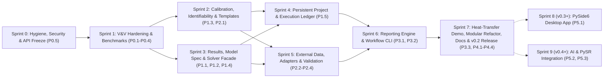

# **Rosolver — Pre-Implementation Audit & Sprint Implementation Roadmap**

**Companion spec:** [`ENG_SPEC.md`](ENG_SPEC.md)  
**Audit date:** 2026-11-26  
**Baseline:** Rosolver `v0.1.0` (`68` passing tests, Python `3.11.13`)  
**Current Release Status:** `v0.2.0` (`150` passing tests) — **Sprints 0–7 Completed**; **Sprints 8–9 Deferred (`v0.3+` / `v0.4+`)**

---

## **0. Sprint Completion Status**

| Sprint | Scope | Spec Coverage | Status |
| --- | --- | --- | --- |
| **Sprint 0** | Hygiene, CI, Safe AST Expression Parser & API Freeze | `P0.5` | ✅ **Completed** |
| **Sprint 1** | 5-State `VerificationStatus`, Hardened GCI/Conservation & 6 Benchmarks | `P0.1`–`P0.4` | ✅ **Completed** |
| **Sprint 2** | Calibration WLS, Identifiability, Diagnostics & `TEMPLATE_REGISTRY` | `P1.3`, `P2.1` | ✅ **Completed** |
| **Sprint 3** | `StandardResult`, Derived SI Units, `Model` Spec & Event Dispatch | `P1.1`, `P1.2`, `P1.4` | ✅ **Completed** |
| **Sprint 4** | Persistent `Project` Workspace, SHA-256 Provenance & Ledger Replay | `P1.5` | ✅ **Completed** |
| **Sprint 5** | `Dataset` I/O, `SolverAdapter`/`VerificationStudy` & `ValidationStudy` | `P2.2`–`P2.4` | ✅ **Completed** |
| **Sprint 6** | Scientific Reporting Engine, 9-Command Workflow CLI & Jupyter Hooks | `P3.1`, `P3.2` | ✅ **Completed** |
| **Sprint 7** | Flagship Heat-Transfer Demo, Modular Subpackages, Docs & `v0.2.0` Gate | `P3.3`, `P4.1`–`P4.4` | ✅ **Completed** |
| **Sprint 8** | PySide6 Desktop App, FiPy/FEniCSx/OpenFOAM Adapters & PDF Export | `P5.1`, `P2.3+` | ⏳ **Deferred (`v0.3+`)** |
| **Sprint 9** | AI-Assisted Model Formulation & PySR Symbolic Regression Ingestion | `P5.2`, `P5.3` | ⏳ **Deferred (`v0.4+`)** |

---

## **1. Pre-Implementation Repository Audit**

Before writing any `v0.2` architecture or feature code, the repository was audited at source, test, git, and dependency levels.

### **1.1 Current Inventory & Verified Baseline**

- **Source (`rosolver/`):** 14 Python modules totaling `6,267` LOC (`dimensions.py`, `system.py`, `symbolic.py`, `numerical.py`, `integrators.py`, `odesys.py`, `pde.py`, `phasechange.py`, `verify.py`, `simulate.py`, `cli.py`, `_parsing.py`, `__init__.py`, `__main__.py`).
- **Tests (`tests/`):** 5 test files totaling `1,295` LOC (`test_rosolver.py`, `test_icing_discovery.py`, `test_simulate.py`, `test_verification.py`, `test_phasechange.py`). All **68 tests pass** in `7.60s`.
- **Examples (`examples/`):** 5 showcase scripts (`919` LOC): `ch1_reproductions.py`, `icing_turbomachinery.py`, `auto_simulate.py`, `verification_suite.py`, `stefan_validation.py`.
- **Installed runtime environment:** Python `3.11.13`, `numpy 2.4.6`, `scipy 1.17.1`, `sympy 1.14.0`, `matplotlib 3.11.2`. Missing in current environment: `pyyaml`, `pandas`, `h5py`, `pydantic`.

### **1.2 Verified Technical Strengths**

1. **Exact dimensional algebra & Buckingham-Pi (`rosolver/dimensions.py`):** Exact `sp.Rational` exponent matrix, canonical coprime integer nullspace vectors, and missing-dimension diagnostics.
2. **DAG dependency engine (`rosolver/system.py`):** Clean qualitative DSL, DFS cycle detection, path enumeration, and rate-identity tracking.
3. **Symbolic chain-rule + Clairaut engine (`rosolver/symbolic.py`):** Automatic active-path pruning, mixed-partial symmetry coupling, Poincare line integration, and LaTeX/step traces.
4. **1D Conservative FVM & MMS (`rosolver/pde.py`):** MUSCL/TVD limiters (`constant`, `linear`, `minmod`, `vanleer`, `mc`), ghost-cell BCs, banded implicit Jacobian sparsity, and exact symbolic `manufactured_source`.
5. **Front-fixing moving-boundary solver (`rosolver/phasechange.py`):** Landau-transformed `Stefan1D` with exact Stefan flux jump, wet/dry Messinger switch, runback film state, and hybrid shedding resets.
6. **Core V&V primitives (`rosolver/verify.py`, `rosolver/integrators.py`):** Celik non-uniform GCI iteration, fixed-step Butcher tableaus (`euler`..`dopri5`, `beuler`, `cn`), stability functions $R(z)$, stiffness ratio, Aitken $\Delta^2$ acceleration, and coupled ODE co-simulation.

### **1.3 Repository Hygiene Blockers (Immediate Fixes Required)**

| Blocker | Observed Evidence | Risk |
| --- | --- | --- |
| **Dirty uncommitted working tree** | `11` modified/deleted tracked files (`README.md`, `rosolver/__init__.py`, `rosolver/simulate.py`, `examples/icing_turbomachinery.py`, moved `ch1.tex` & 3 `.tex`/`.pdf` pairs) + `8` untracked paths (`rosolver/phasechange.py`, `tests/test_phasechange.py`, `examples/stefan_validation.py`, `docs/architecture/`, `docs/notes/`, `docs/refs/`, 2 figures) | Unversioned `Stefan1D` code and half-migrated `docs/` paths destabilize feature branching |
| **Stray empty directory** | `./-` exists in repository root | Tooling/CLI flag accident; pollutes workspace |
| **Broken links in `README.md`** | `README.md:5` links `ch1.tex` (now at `docs/refs/ch1.tex`); `README.md:210` links `docs/stefan_front_tracking_notes.pdf` (now at `docs/notes/stefan_front_tracking_notes.pdf`) | Broken documentation links on landing page |
| **No CI workflow** | No `.github/workflows/` directory present | Regressions can slip into `main` unchecked |

### **1.4 Code-Level Scientific, Security & Architecture Debt**

| Area | Location | Observed Issue | Spec Ref |
| --- | --- | --- | --- |
| **Unsafe expression parsing** | `rosolver/_parsing.py:60` | Calls `sp.sympify(value, locals=local)`, which evaluates Python syntax internally; unsafe for YAML/JSON/external model loading | `P0.5` |
| **GCI / Celik edge cases** | `rosolver/verify.py:99-221` | `_celik_observed_order` silently `break`s on `num * den <= 0` and uses `abs(ln(ratio) + q)`; `gci_from_values` silently drops $>3$ grids (line `137`), clamps `p_eff` to `[0.1, 10.0]` without warning (line `187`), and allows `"oscillatory"` regime to report `passed=True` (line `198`) | `P0.1`, `P0.3` |
| **Overstated V&V terminology** | `README.md:3,147`, `rosolver/cli.py:76`, `rosolver/verify.py:2,62` | Claims "ASME V&V 20" without explicit non-certification framing; binary `passed: bool` instead of 5-state classification | `P0.1` |
| **Conservation semantics** | `rosolver/pde.py:344-351`, `rosolver/verify.py:522-558` | RK-stage flux/source ledger (`rhs_aug`) proves internal accounting consistency, not independent discrete PDE conservation or physical correctness | `P0.4` |
| **Silent solver failures** | `rosolver/integrators.py:270`, `odesys.py:163`, `pde.py:330`, `phasechange.py:600` | `integrate_fixed` counts `newton_failures`, but `ODESystem.solve`, `ConservationLaw1D.solve`, and `Stefan1D.solve` drop it (`ODESystem.solve` hardcodes `success=True` for fixed-step and returns `success=False` silently on `solve_ivp`, whereas `pde.py`/`phasechange.py` raise `RuntimeError`) | `P0.4` |
| **Benchmark gaps** | `tests/test_phasechange.py:41,63`, `tests/test_verification.py` | Stefan Neumann test uses loose `rtol=1e-2` and checks monotonic error decay without observed convergence order; no analytical 1D transient heat-conduction Fourier benchmark; no published Celik (2008) table check | `P0.2` |
| **Calibration & identifiability** | `rosolver/numerical.py:215-568` | Missing WLS (`sigma_y`), missing-data policy, parameter correlation matrix, and Jacobian condition/rank warnings (`pinv` masks collinearity); `rank_candidates` (`L467`) and `select_sparse_pi` (`L557`) silently swallow exceptions (`except Exception: continue`) | `P2.1` |
| **Template duplication** | `rosolver/symbolic.py:351-435`, `rosolver/numerical.py:522-536` | `power`, `hill`, and `exp_sat` Pi-templates are duplicated across two modules instead of using a single extensible registry | `P1.3` |
| **Symbolic edge cases** | `rosolver/symbolic.py:756-780`, `rosolver/system.py:35` | Dead `pass` block (`L756-760`); `_solve_intercept_term` ignores units/dimensions (`L769-780`); `Variable` forces `positive=True` on all symbols (`system.py:35`) | `P1.3` |
| **Missing derived SI units** | `rosolver/dimensions.py:21-30` | `UNIT_TO_DIM` maps only 8 base aliases (`kg, m, s, sec, A, K, mol, cd`), lacking `N, J, W, Pa, Hz, V, C, Ohm` | `P1.2` |
| **Fragmented result & solver APIs** | `rosolver/odesys.py`, `numerical.py`, `pde.py`, `phasechange.py`, `simulate.py` | 7 unaligned result dataclasses; `ODESystem` lacks event detection; no unified `Model.solve()` entry point | `P1.1`, `P1.4` |

### **1.5 Completely Unimplemented Spec Layers**

- Validated `Model` schema & YAML/JSON serialization (`P1.2`)
- Persistent `Project` structure & append-only execution ledger (`P1.5`)
- Standard external dataset loader & `SolverAdapter` interface (`P2.2`, `P2.3`)
- Experimental `ValidationStudy` engine (`P2.4`)
- Structured Markdown/figure reporting engine (`P3.1`)
- Workflow subcommand CLI (`init`, `validate`, `calibrate`, `simulate`, `verify`, `validate-results`, `report`, `info`) (`P3.2`)
- Workflow-oriented `docs/` tree (`P4.3`), PySide6 desktop app (`P5.1`), AI/PySR layer (`P5.2`)

---

## **2. General Implementation Strategy & Governance**

### **2.1 Guiding Rules**

1. **Credibility before expansion:** Fix parsing security, V&V edge cases, and independent analytical benchmarks (`P0`) before introducing `Model`, `Project`, CLI subcommands, or UI abstractions.
2. **Zero regression on existing APIs:** Every symbol currently in `rosolver/__init__.__all__` and every existing test (`68+`) must remain passing across every sprint via compatibility re-exports.
3. **Minimal core dependencies:** Keep runtime core limited to `numpy`, `scipy`, `sympy`, `matplotlib`, and `pyyaml` (added in Sprint 3 for `P1.2`). Place `h5py`, `pandas`, PDF tooling, `PySide6`, and AI/symbolic-regression packages in optional `pyproject.toml` extras.
4. **One sprint, one vertical outcome:** Each sprint delivers testable, documented functionality with zero duplicate ownership across sprints.

### **2.2 Sprint Definition of Done (DoD)**

A sprint closes only when:
- All scoped `ENG_SPEC.md` acceptance criteria pass automated tests (`pytest` unit, integration, and benchmark suites).
- No existing tests or `rosolver/__init__.__all__` exports break.
- Scientific assumptions, limitations, and docstrings are updated alongside code.
- CI passes cleanly on a clean working tree with zero untracked scratch artifacts.

---

## **3. Sprint Dependency Map**

---

## **4. Sprint-by-Sprint Implementation Plan (`v0.2`)**

### **Sprint 0 — Hygiene, API Freeze & Security Baseline — ✅ Completed**
- **Goal:** Establish a clean, CI-protected baseline and eliminate expression-evaluation risk before any refactoring.
- **Spec coverage:** `P0.5` (expression security) + repo hygiene blockers.
- **Deliverables:**
  1. Remove stray `./-` directory; commit/stage pending `Stefan1D` (`rosolver/phasechange.py`, `tests/test_phasechange.py`, `examples/stefan_validation.py`) and relocated `docs/notes/`, `docs/refs/`, `docs/architecture/` cleanly.
  2. Fix broken paths in `README.md` (`docs/refs/ch1.tex`, `docs/notes/stefan_front_tracking_notes.pdf`) and refine ASME V&V 20 phrasing to avoid implying certification.
  3. Add `.github/workflows/ci.yml` running `pytest` on push/PR across Python `3.10`–`3.12`.
  4. Replace `sp.sympify()` on raw strings in `rosolver/_parsing.py` with a strict Python `ast.parse` validator/converter supporting allow-listed arithmetic operators, math functions, and declared symbols only; add adversarial injection tests.
  5. Add regression test asserting `rosolver.__all__` public surface stability.
- **Exit gate:** Clean `git status`, green CI, `>68` tests passing including security parser tests.

### **Sprint 1 — Verification Hardening & Independent Scientific Benchmarks (`P0`) — ✅ Completed**
- **Goal:** Make Rosolver's existing V&V and solver diagnostics scientifically unimpeachable.
- **Spec coverage:** `P0.1`, `P0.2`, `P0.3`, `P0.4`.
- **Deliverables:**
  1. Introduce 5-state `VerificationStatus` (`Passed`, `Failed`, `Inconclusive`, `NotAssessed`, `Warning`) across `GCIReport`, `MMSReport`, `TimestepReport`, `ConservationAuditReport`, and `StiffnessReport` (preserving `.passed` as a backwards-compatible property/field where needed).
  2. Harden `rosolver/verify.py`:
     - Fix `_celik_observed_order` failure handling (`num * den <= 0` -> explicit warning & `Inconclusive`), remove silent `p_eff` clamping without warning, flag `oscillatory` / `r < 1.3` / $>3$ grids explicitly.
     - Clarify `audit_pde_conservation` documentation and output labels as *internal flux-source accounting consistency* distinct from discrete PDE conservation and physical correctness.
  3. Propagate `newton_failures` from `rosolver/integrators.py` into `Trajectory`, `PDESolution`, and `StefanSolution`; unify failure semantics across `ODESystem`, `ConservationLaw1D`, and `Stefan1D`.
  4. Build `tests/benchmarks/` implementing all **6 required independent benchmarks** (`P0.2`), including Celik et al. (2008) GCI reference check, 1D transient heat conduction vs analytical Fourier series, and `Stefan1D` spatial convergence-order verification.
- **Exit gate:** All 6 `P0.2` independent benchmarks and hardened V&V edge-case tests pass in CI.

### **Sprint 2 — Calibration Upgrade, Identifiability & Pluggable Templates — ✅ Completed**
- **Goal:** Upgrade empirical calibration and decouple candidate equation templates from core solver loops.
- **Spec coverage:** `P1.3`, `P2.1`.
- **Deliverables:**
  1. Create a pluggable `EquationTemplate` registry (`Monomial`, `Affine`, `SaturatingHill`, `RosinRammler`) shared by `symbolic.py` and `numerical.py` so new templates register without core edits (`P1.3`).
  2. Fix `symbolic.py` gaps: remove dead `pass` block (`L756-760`), dimensionally validate `_solve_intercept_term`, allow signed/unbounded variables alongside `positive=True` where appropriate, and record derivation/rejection provenance per candidate.
  3. Upgrade `rosolver/numerical.py` (`P2.1`):
     - Add **Weighted Least Squares (WLS)** via measurement uncertainties (`sigma_y`) and explicit missing-data policies (`raise`, `drop`, `mask`).
     - Compute parameter correlation matrix, Jacobian singular values / condition number, and confidence intervals; emit explicit non-identifiability warnings.
     - Replace silent `except Exception: continue` in `rank_candidates` and `select_sparse_pi` with recorded rejection diagnostics.
     - Distinguish mathematical admissibility, statistical fit (BIC/AIC/RMSE), and physical plausibility in ranking outputs.
- **Exit gate:** Synthetic parameter recovery benchmark passes with noise, weights, missing values, and collinearity warning assertions.

### **Sprint 3 — Standardized Results, Model Specification & Unified Numerics — ✅ Completed**
- **Goal:** Introduce the central solver-independent `Model` spec and standardized result structures.
- **Spec coverage:** `P1.1`, `P1.2`, `P1.4`.
- **Deliverables:**
  1. Define common result/provenance base structure (`to_dict`, `to_json`, `status`, `warnings`, `assumptions`, `solver_config`, `units`, `timing_s`) across simulation, calibration, and verification outputs (`P1.1`).
  2. Add derived SI unit aliases (`N`, `J`, `W`, `Pa`, `Hz`, `V`, `C`, `Ohm`, etc.) to `rosolver/dimensions.py` without disturbing custom domain dimensions (`P1.2`).
  3. Implement validated `Model`, `Variable`, `Parameter`, `Equation`, and `Condition` classes with acyclic DAG checks and safe `yaml.safe_load` / JSON round-trip serialization (`pyyaml` added to `pyproject.toml`) (`P1.2`).
  4. Add event detection to `ODESystem.solve(...)` and build unified `model.solve(...)` dispatch across ODE, 1D PDE, and `Stefan1D` while keeping all existing solver classes untouched for backwards compatibility (`P1.4`).
- **Exit gate:** `Model` specs load from YAML, reject cyclic/invalid definitions, solve ODE and 1D heat PDEs via `model.solve()`, and emit standardized result objects.

### **Sprint 4 — Persistent Scientific Project & Execution Ledger — ✅ Completed**
- **Goal:** Make complete modelling workflows persistent, hash-verified, and reproducible on disk.
- **Spec coverage:** `P1.5`.
- **Deliverables:**
  1. Implement `Project` workspace manager (`project.yaml`, `models/`, `data/`, `calibration/`, `simulations/`, `verification/`, `validation/`, `reports/`, `logs/`).
  2. Implement SHA-256 hashing of models and datasets, software/OS/dependency/seed provenance capture, and an append-only execution ledger (`run` records).
  3. Support reopening moved projects cleanly via project-relative paths and explicit errors on missing/modified input hashes.
- **Exit gate:** Round-trip project save/reload/rerun test reproduces simulation and calibration outputs from stored configuration.

### **Sprint 5 — External Data Import, Solver Adapters & Experimental Validation — ✅ Completed**
- **Goal:** Enable Rosolver to ingest external solver outputs and experimental datasets with uncertainty quantification.
- **Spec coverage:** `P2.2`, `P2.3`, `P2.4`.
- **Deliverables:**
  1. Implement standard `Dataset` import for CSV, JSON, YAML, and NumPy arrays (plus optional `rosolver[io]` extras for HDF5/Pandas) with coordinate, field, unit, and uncertainty metadata (`P2.2`).
  2. Implement `SolverAdapter` ABC and generic CSV/NumPy external-code adapter (`VerificationStudy.from_csv(...)` or equivalent) marking unavailable metadata explicitly (`P2.3`).
  3. Implement `ValidationStudy` comparing simulation predictions + $u_{\text{num}}$ against multi-point experimental measurements + $u_{\text{exp}}$, producing validation error metrics, 5-state classification, and comparison plots (`P2.4`).
- **Exit gate:** External CSV mesh-study GCI verification (`Benchmark 6`) and multi-point experimental validation study pass in CI.

### **Sprint 6 — Scientific Reporting Engine & Workflow CLI — ✅ Completed**
- **Goal:** Produce reproducible human/machine-readable scientific reports and expose the full workflow via CLI and Python API.
- **Spec coverage:** `P3.1`, `P3.2`.
- **Deliverables:**
  1. Build `reporting` module generating **Markdown** reports, linked **PNG/SVG** figures, and **JSON/YAML** manifests directly from structured results and execution ledger run IDs (covering all 8 report scopes, visible `Failed`/`Inconclusive` flags, units, assumptions, and limitations) (`P3.1`).
  2. Add workflow CLI subcommands (`init`, `validate`, `model analyse`, `calibrate`, `simulate`, `verify`, `validate-results`, `report`, `info`) with `--json`, progress output, and explicit exit codes, while preserving legacy CLI flags (`--rel`, `--gci`, `--sweep`, `--plot`) (`P3.2`).
  3. Add lightweight Jupyter rich-display hooks (`_repr_markdown_`, etc.) with zero IPython runtime dependency (`P3.2`).
- **Exit gate:** End-to-end CLI subcommand integration tests run headlessly and verify JSON output, exit codes, and generated Markdown reports.

### **Sprint 7 — `v0.2` Flagship Heat-Transfer Demo, Incremental Modularization, Docs & Release — ✅ Completed**
- **Goal:** Ship `v0.2` with one cohesive end-to-end engineering study, clean modular layout, and full scientific documentation.
- **Spec coverage:** `P3.3`, `P4.1`, `P4.2`, `P4.3`, `P4.4`.
- **Deliverables:**
  1. Build the flagship **1D transient heat conduction** example project executing the full 9-step lifecycle (model YAML → dimensional check → formulation → FVM PDE solve → analytical Fourier comparison → MMS → GCI/timestep convergence → conservation audit → Markdown report) (`P3.3`).
  2. Incrementally organize modules into `core/`, `symbolic/`, `calibration/`, `numerics/`, `verification/`, `validation/`, `integrations/`, `io/`, `reporting/` while retaining 100% backwards-compatible re-exports in `rosolver/__init__.py` (`P4.1`).
  3. Record baseline benchmark runtimes and complete workflow-oriented `docs/` with the 8-item method documentation standard (`P4.2`, `P4.3`).
  4. Bump version to `0.2.0`, configure optional dependency extras in `pyproject.toml`, and verify the `v0.2` release gate checklist (`P4.4`).
- **Exit gate:** All `P4.4` success metrics met; clean PyPI wheel/sdist build; full CI pass.

### **Post-`v0.2` Deferred Sprints (⏳ Deferred)**
- **Sprint 8 (`v0.3+` — `P5.1`, `P2.3` extended adapters — ⏳ Deferred):** PySide6 thin-client desktop application (7 views over public API, non-blocking worker execution) + native FiPy / FEniCSx / OpenFOAM adapters + optional PDF report export.
- **Sprint 9 (`v0.4+` — `P5.2`, `P5.3` — ⏳ Deferred):** Optional AI-assisted draft model formulation and PySR symbolic-regression candidate ingestion gated strictly by deterministic schema, dimensional, and V&V checks.

---

## **5. Where to Start Sprint Implementation**

**Start immediately with Sprint 0 (Hygiene, API Freeze & Security Baseline), then execute Sprint 1 (`P0` Verification Hardening & Independent Benchmarks).**

### **Why Here (Not `Model`, `Project`, CLI, or GUI)**

1. **Uncommitted baseline risk:** `rosolver/phasechange.py`, `tests/test_phasechange.py`, relocated `docs/`, and `./-` sit uncommitted in the working tree. Branching architectural refactors before committing and adding CI risks losing or tangling `v0.1.0` work.
2. **Security prerequisite:** `Model` YAML loading (`P1.2`) parses equation strings from files. Fixing `sp.sympify()` in `rosolver/_parsing.py` (`P0.5`) first ensures `Model` never inherits an arbitrary code-execution vector.
3. **Credibility prerequisite:** `Project`, reporting (`P3.1`), and the flagship heat-transfer demo (`P3.3`) consume `GCIReport`, `MMSReport`, `ConservationAuditReport`, and solver statuses. Fixing Celik/GCI edge cases, `newton_failures` propagation, 5-state classification, and independent analytical benchmarks (`P0.1`–`P0.4`) prevents building persistence and reports on flawed diagnostics.

### **Immediate First 5 Actions (Sprint 0 Kickoff)**

1. Inspect and remove empty `./-` directory; review and commit `Stefan1D` (`phasechange.py`), tests, examples, and moved `docs/` cleanly onto `main` (or a stabilization branch).
2. Fix broken `ch1.tex` and `stefan_front_tracking_notes.pdf` paths in `README.md` and soften ASME V&V 20 phrasing.
3. Add `.github/workflows/ci.yml` running `pytest -v`.
4. Harden `rosolver/_parsing.py` with an AST whitelist parser + injection unit tests.
5. Add a `rosolver.__all__` public API snapshot test, then begin Sprint 1 (`VerificationStatus` + `tests/benchmarks/`).
