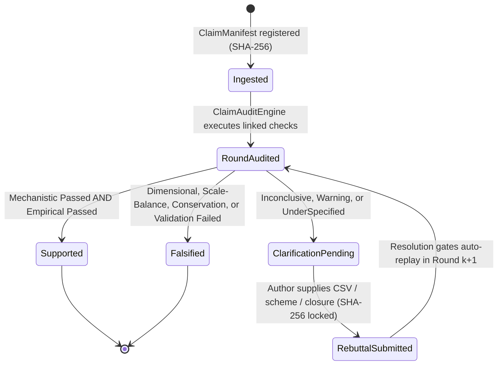

# **Rosolver — Pre-Implementation Audit & Sprint Implementation Roadmap**

**Companion spec:** [`ENG_SPEC.md`](ENG_SPEC.md)  
**Audit date:** 2026-11-26 (Updated: 2026-11-27 — Sprint 10 Priority Track & Sprint 8/9 Rescope)  
**Baseline:** Rosolver `v0.1.0` (`68` passing tests, Python `3.11.13`)  
**Current Release Status:** `v0.2.0` + **Sprints 0–10 & Carbon Audit Hardening All Complete** (`183` passing tests incl. `rosolver.claims`, OpenFOAM/FEniCSx/HDF5 adapters, headless LaTeX/PDF renderer, PySR `CandidateImporter`, `rosolver-mcp` `15` tools & `CARBON_AUDIT.md` fixes)

---

## **0. Sprint Completion Status**

| Sprint | Scope | Spec Coverage | Status |
| --- | --- | --- | --- |
| **Sprint 0** | Hygiene, CI, Safe AST Expression Parser & API Freeze | `P0.5` | ✅ **Completed** |
| **Sprint 1** | 5-State `VerificationStatus`, Hardened GCI/Conservation & 6 Benchmarks | `P0.1`–`P0.4` | ✅ **Completed** |
| **Sprint 2** | Calibration WLS, Identifiability, Diagnostics & `TEMPLATE_REGISTRY` | `P1.3`, `P2.1` | ✅ **Completed** |
| **Sprint 3** | `StandardResult`, Derived SI Units, `Model` Spec & Event Dispatch | `P1.1`, `P1.2`, `P1.4` | ✅ **Completed** |
| **Sprint 4** | Persistent `Project` Workspace, SHA-256 Provenance & Ledger Replay | `P1.5` | ✅ **Completed** |
| **Sprint 5** | `Dataset` I/O, `SolverAdapter`/`VerificationStudy` & `ValidationStudy` | `P2.2`–`P2.4` | ✅ **Completed** |
| **Sprint 6** | Scientific Reporting Engine, 9-Command Workflow CLI & Jupyter Hooks | `P3.1`, `P3.2` | ✅ **Completed** |
| **Sprint 7** | Flagship Heat-Transfer Demo, Modular Subpackages, Docs & `v0.2.0` Gate | `P3.3`, `P4.1`–`P4.4` | ✅ **Completed** |
| **`v0.2` MCP Extension** | Zero-Dependency `rosolver-mcp` Server (`10` Tools, `4` Resources, `2` Prompts) | `P3.2+`, `P5.2` base | ✅ **Completed** |
| **Sprint 10 (`v0.3.0`)** | Deterministic Scientific Claim Verification, Scale-Separation Audit & Stateful Peer-Review Clarification Engine | `P5.4` (`P0.1`–`P0.5`, `P1.5`, `P2.4`, `P3.1`, `P5.2` gate) | ✅ **Completed** |
| **Sprint 8 (Slim — `v0.3.1`)** | External CFD/FEM Audit Adapters (OpenFOAM, FEniCSx, HDF5) & Headless LaTeX/PDF Referee Export *(PySide6 GUI `P5.1` archived)* | `P2.3+`, `P3.1+` | ✅ **Completed** |
| **Sprint 9 (Slim — `v0.4.0`)** | PySR / External Symbolic-Regression Candidate Importer Gated by Sprint 10 *(in-repo LLM SDK wrappers dropped in favor of `rosolver-mcp`)* | `P5.2` (slim) | ✅ **Completed** |
| **Archived (`P5.1` / `rosolver.ai`)** | PySide6 Desktop Qt App & In-Package Vendor LLM SDK Wrappers | `P5.1`, `P5.3` | 🗄️ **Archived / Superseded by MCP** |

---

## **1. Pre-Implementation Repository Audit**

Before writing any `v0.2` architecture or feature code, the repository was audited at source, test, git, and dependency levels.

### **1.1 Current Inventory & Verified Baseline**

- **Source (`rosolver/`):** 14 Python modules totaling `6,267` LOC (`dimensions.py`, `system.py`, `symbolic.py`, `numerical.py`, `integrators.py`, `odesys.py`, `pde.py`, `phasechange.py`, `verify.py`, `simulate.py`, `cli.py`, `_parsing.py`, `__init__.py`, `__main__.py`).
- **Tests (`tests/`):** 5 test files totaling `1,295` LOC (`test_rosolver.py`, `test_icing_discovery.py`, `test_simulate.py`, `test_verification.py`, `test_phasechange.py`). All **68 tests pass** in `7.60s`.
- **Examples (`examples/`):** 5 showcase scripts (`919` LOC): `ch1_reproductions.py`, `icing_turbomachinery.py`, `auto_simulate.py`, `verification_suite.py`, `stefan_validation.py`.
- **Installed runtime environment:** Python `3.11.13`, `numpy 2.4.6`, `scipy 1.17.1`, `sympy 1.14.0`, `matplotlib 3.11.2`. Missing in current environment: `pyyaml`, `pandas`, `h5py`, `pydantic`.

### **1.2 Verified Technical Strengths**

1. **Exact dimensional algebra & Buckingham-Pi (`rosolver/dimensions.py`):** Exact `sp.Rational` exponent matrix, canonical coprime integer nullspace vectors, and missing-dimension diagnostics.
2. **DAG dependency engine (`rosolver/system.py`):** Clean qualitative DSL, DFS cycle detection, path enumeration, and rate-identity tracking.
3. **Symbolic chain-rule + Clairaut engine (`rosolver/symbolic.py`):** Automatic active-path pruning, mixed-partial symmetry coupling, Poincare line integration, and LaTeX/step traces.
4. **1D Conservative FVM & MMS (`rosolver/pde.py`):** MUSCL/TVD limiters (`constant`, `linear`, `minmod`, `vanleer`, `mc`), ghost-cell BCs, banded implicit Jacobian sparsity, and exact symbolic `manufactured_source`.
5. **Front-fixing moving-boundary solver (`rosolver/phasechange.py`):** Landau-transformed `Stefan1D` with exact Stefan flux jump, wet/dry Messinger switch, runback film state, and hybrid shedding resets.
6. **Core V&V primitives (`rosolver/verify.py`, `rosolver/integrators.py`):** Celik non-uniform GCI iteration, fixed-step Butcher tableaus (`euler`..`dopri5`, `beuler`, `cn`), stability functions $R(z)$, stiffness ratio, Aitken $\Delta^2$ acceleration, and coupled ODE co-simulation.

### **1.3 Repository Hygiene Blockers (Immediate Fixes Required)**

| Blocker | Observed Evidence | Risk |
| --- | --- | --- |
| **Dirty uncommitted working tree** | `11` modified/deleted tracked files (`README.md`, `rosolver/__init__.py`, `rosolver/simulate.py`, `examples/icing_turbomachinery.py`, moved `ch1.tex` & 3 `.tex`/`.pdf` pairs) + `8` untracked paths (`rosolver/phasechange.py`, `tests/test_phasechange.py`, `examples/stefan_validation.py`, `docs/architecture/`, `docs/notes/`, `docs/refs/`, 2 figures) | Unversioned `Stefan1D` code and half-migrated `docs/` paths destabilize feature branching |
| **Stray empty directory** | `./-` exists in repository root | Tooling/CLI flag accident; pollutes workspace |
| **Broken links in `README.md`** | `README.md:5` links `ch1.tex` (now at `docs/refs/ch1.tex`); `README.md:210` links `docs/stefan_front_tracking_notes.pdf` (now at `docs/notes/stefan_front_tracking_notes.pdf`) | Broken documentation links on landing page |
| **No CI workflow** | No `.github/workflows/` directory present | Regressions can slip into `main` unchecked |

### **1.4 Code-Level Scientific, Security & Architecture Debt**

| Area | Location | Observed Issue | Spec Ref |
| --- | --- | --- | --- |
| **Unsafe expression parsing** | `rosolver/_parsing.py:60` | Calls `sp.sympify(value, locals=local)`, which evaluates Python syntax internally; unsafe for YAML/JSON/external model loading | `P0.5` |
| **GCI / Celik edge cases** | `rosolver/verify.py:99-221` | `_celik_observed_order` silently `break`s on `num * den <= 0` and uses `abs(ln(ratio) + q)`; `gci_from_values` silently drops $>3$ grids (line `137`), clamps `p_eff` to `[0.1, 10.0]` without warning (line `187`), and allows `"oscillatory"` regime to report `passed=True` (line `198`) | `P0.1`, `P0.3` |
| **Overstated V&V terminology** | `README.md:3,147`, `rosolver/cli.py:76`, `rosolver/verify.py:2,62` | Claims "ASME V&V 20" without explicit non-certification framing; binary `passed: bool` instead of 5-state classification | `P0.1` |
| **Conservation semantics** | `rosolver/pde.py:344-351`, `rosolver/verify.py:522-558` | RK-stage flux/source ledger (`rhs_aug`) proves internal accounting consistency, not independent discrete PDE conservation or physical correctness | `P0.4` |
| **Silent solver failures** | `rosolver/integrators.py:270`, `odesys.py:163`, `pde.py:330`, `phasechange.py:600` | `integrate_fixed` counts `newton_failures`, but `ODESystem.solve`, `ConservationLaw1D.solve`, and `Stefan1D.solve` drop it (`ODESystem.solve` hardcodes `success=True` for fixed-step and returns `success=False` silently on `solve_ivp`, whereas `pde.py`/`phasechange.py` raise `RuntimeError`) | `P0.4` |
| **Benchmark gaps** | `tests/test_phasechange.py:41,63`, `tests/test_verification.py` | Stefan Neumann test uses loose `rtol=1e-2` and checks monotonic error decay without observed convergence order; no analytical 1D transient heat-conduction Fourier benchmark; no published Celik (2008) table check | `P0.2` |
| **Calibration & identifiability** | `rosolver/numerical.py:215-568` | Missing WLS (`sigma_y`), missing-data policy, parameter correlation matrix, and Jacobian condition/rank warnings (`pinv` masks collinearity); `rank_candidates` (`L467`) and `select_sparse_pi` (`L557`) silently swallow exceptions (`except Exception: continue`) | `P2.1` |
| **Template duplication** | `rosolver/symbolic.py:351-435`, `rosolver/numerical.py:522-536` | `power`, `hill`, and `exp_sat` Pi-templates are duplicated across two modules instead of using a single extensible registry | `P1.3` |
| **Symbolic edge cases** | `rosolver/symbolic.py:756-780`, `rosolver/system.py:35` | Dead `pass` block (`L756-760`); `_solve_intercept_term` ignores units/dimensions (`L769-780`); `Variable` forces `positive=True` on all symbols (`system.py:35`) | `P1.3` |
| **Missing derived SI units** | `rosolver/dimensions.py:21-30` | `UNIT_TO_DIM` maps only 8 base aliases (`kg, m, s, sec, A, K, mol, cd`), lacking `N, J, W, Pa, Hz, V, C, Ohm` | `P1.2` |
| **Fragmented result & solver APIs** | `rosolver/odesys.py`, `numerical.py`, `pde.py`, `phasechange.py`, `simulate.py` | 7 unaligned result dataclasses; `ODESystem` lacks event detection; no unified `Model.solve()` entry point | `P1.1`, `P1.4` |

### **1.5 Completely Unimplemented Spec Layers**

- Validated `Model` schema & YAML/JSON serialization (`P1.2`)
- Persistent `Project` structure & append-only execution ledger (`P1.5`)
- Standard external dataset loader & `SolverAdapter` interface (`P2.2`, `P2.3`)
- Experimental `ValidationStudy` engine (`P2.4`)
- Structured Markdown/figure reporting engine (`P3.1`)
- Workflow subcommand CLI (`init`, `validate`, `calibrate`, `simulate`, `verify`, `validate-results`, `report`, `info`) (`P3.2`)
- Workflow-oriented `docs/` tree (`P4.3`), PySide6 desktop app (`P5.1`), AI/PySR layer (`P5.2`)

---

## **2. General Implementation Strategy & Governance**

### **2.1 Guiding Rules**

1. **Credibility before expansion:** Fix parsing security, V&V edge cases, and independent analytical benchmarks (`P0`) before introducing `Model`, `Project`, CLI subcommands, or UI abstractions.
2. **Zero regression on existing APIs:** Every symbol currently in `rosolver/__init__.__all__` and every existing test (`68+`) must remain passing across every sprint via compatibility re-exports.
3. **Minimal core dependencies:** Keep runtime core limited to `numpy`, `scipy`, `sympy`, `matplotlib`, and `pyyaml` (added in Sprint 3 for `P1.2`). Place `h5py`, `pandas`, PDF tooling, `PySide6`, and AI/symbolic-regression packages in optional `pyproject.toml` extras.
4. **One sprint, one vertical outcome:** Each sprint delivers testable, documented functionality with zero duplicate ownership across sprints.

### **2.2 Sprint Definition of Done (DoD)**

A sprint closes only when:
- All scoped `ENG_SPEC.md` acceptance criteria pass automated tests (`pytest` unit, integration, and benchmark suites).
- No existing tests or `rosolver/__init__.__all__` exports break.
- Scientific assumptions, limitations, and docstrings are updated alongside code.
- CI passes cleanly on a clean working tree with zero untracked scratch artifacts.

---

## **3. Sprint Dependency Map**

```mermaid
flowchart LR
    S0["Sprint 0: Hygiene, Security & API Freeze (P0.5)"] --> S1["Sprint 1: V&V Hardening & Benchmarks (P0.1-P0.4)"]
    S1 --> S2["Sprint 2: Calibration, Identifiability & Templates (P1.3, P2.1)"]
    S1 --> S3["Sprint 3: Results, Model Spec & Solver Facade (P1.1, P1.2, P1.4)"]
    S2 --> S4["Sprint 4: Persistent Project & Execution Ledger (P1.5)"]
    S3 --> S4
    S2 --> S5["Sprint 5: External Data, Adapters & Validation (P2.2-P2.4)"]
    S3 --> S5
    S4 --> S6["Sprint 6: Reporting Engine & Workflow CLI (P3.1, P3.2)"]
    S5 --> S6
    S6 --> S7["Sprint 7: Heat-Transfer Demo, Modular Refactor, Docs & v0.2 Release (P3.3, P4.1-P4.4)"]
    S7 --> MCP["v0.2.0 MCP Extension: 10-Tool Deterministic Server"]
    MCP --> S10["Sprint 10 (v0.3.0): Claim Verification, Scale Audit & Peer-Review Engine (P5.4)"]
    S10 --> S8["Sprint 8 Slim (v0.3.1): OpenFOAM/FEniCSx Audit Adapters & Headless PDF Export (P2.3+, P3.1+)"]
    S8 --> S9["Sprint 9 Slim (v0.4.0): PySR Candidate Importer Gated by Sprint 10 (P5.2 Slim)"]
```



---

## **4. Sprint-by-Sprint Implementation Plan (`v0.2`)**

### **Sprint 0 — Hygiene, API Freeze & Security Baseline — ✅ Completed**
- **Goal:** Establish a clean, CI-protected baseline and eliminate expression-evaluation risk before any refactoring.
- **Spec coverage:** `P0.5` (expression security) + repo hygiene blockers.
- **Deliverables:**
  1. Remove stray `./-` directory; commit/stage pending `Stefan1D` (`rosolver/phasechange.py`, `tests/test_phasechange.py`, `examples/stefan_validation.py`) and relocated `docs/notes/`, `docs/refs/`, `docs/architecture/` cleanly.
  2. Fix broken paths in `README.md` (`docs/refs/ch1.tex`, `docs/notes/stefan_front_tracking_notes.pdf`) and refine ASME V&V 20 phrasing to avoid implying certification.
  3. Add `.github/workflows/ci.yml` running `pytest` on push/PR across Python `3.10`–`3.12`.
  4. Replace `sp.sympify()` on raw strings in `rosolver/_parsing.py` with a strict Python `ast.parse` validator/converter supporting allow-listed arithmetic operators, math functions, and declared symbols only; add adversarial injection tests.
  5. Add regression test asserting `rosolver.__all__` public surface stability.
- **Exit gate:** Clean `git status`, green CI, `>68` tests passing including security parser tests.

### **Sprint 1 — Verification Hardening & Independent Scientific Benchmarks (`P0`) — ✅ Completed**
- **Goal:** Make Rosolver's existing V&V and solver diagnostics scientifically unimpeachable.
- **Spec coverage:** `P0.1`, `P0.2`, `P0.3`, `P0.4`.
- **Deliverables:**
  1. Introduce 5-state `VerificationStatus` (`Passed`, `Failed`, `Inconclusive`, `NotAssessed`, `Warning`) across `GCIReport`, `MMSReport`, `TimestepReport`, `ConservationAuditReport`, and `StiffnessReport` (preserving `.passed` as a backwards-compatible property/field where needed).
  2. Harden `rosolver/verify.py`:
     - Fix `_celik_observed_order` failure handling (`num * den <= 0` -> explicit warning & `Inconclusive`), remove silent `p_eff` clamping without warning, flag `oscillatory` / `r < 1.3` / $>3$ grids explicitly.
     - Clarify `audit_pde_conservation` documentation and output labels as *internal flux-source accounting consistency* distinct from discrete PDE conservation and physical correctness.
  3. Propagate `newton_failures` from `rosolver/integrators.py` into `Trajectory`, `PDESolution`, and `StefanSolution`; unify failure semantics across `ODESystem`, `ConservationLaw1D`, and `Stefan1D`.
  4. Build `tests/benchmarks/` implementing all **6 required independent benchmarks** (`P0.2`), including Celik et al. (2008) GCI reference check, 1D transient heat conduction vs analytical Fourier series, and `Stefan1D` spatial convergence-order verification.
- **Exit gate:** All 6 `P0.2` independent benchmarks and hardened V&V edge-case tests pass in CI.

### **Sprint 2 — Calibration Upgrade, Identifiability & Pluggable Templates — ✅ Completed**
- **Goal:** Upgrade empirical calibration and decouple candidate equation templates from core solver loops.
- **Spec coverage:** `P1.3`, `P2.1`.
- **Deliverables:**
  1. Create a pluggable `EquationTemplate` registry (`Monomial`, `Affine`, `SaturatingHill`, `RosinRammler`) shared by `symbolic.py` and `numerical.py` so new templates register without core edits (`P1.3`).
  2. Fix `symbolic.py` gaps: remove dead `pass` block (`L756-760`), dimensionally validate `_solve_intercept_term`, allow signed/unbounded variables alongside `positive=True` where appropriate, and record derivation/rejection provenance per candidate.
  3. Upgrade `rosolver/numerical.py` (`P2.1`):
     - Add **Weighted Least Squares (WLS)** via measurement uncertainties (`sigma_y`) and explicit missing-data policies (`raise`, `drop`, `mask`).
     - Compute parameter correlation matrix, Jacobian singular values / condition number, and confidence intervals; emit explicit non-identifiability warnings.
     - Replace silent `except Exception: continue` in `rank_candidates` and `select_sparse_pi` with recorded rejection diagnostics.
     - Distinguish mathematical admissibility, statistical fit (BIC/AIC/RMSE), and physical plausibility in ranking outputs.
- **Exit gate:** Synthetic parameter recovery benchmark passes with noise, weights, missing values, and collinearity warning assertions.

### **Sprint 3 — Standardized Results, Model Specification & Unified Numerics — ✅ Completed**
- **Goal:** Introduce the central solver-independent `Model` spec and standardized result structures.
- **Spec coverage:** `P1.1`, `P1.2`, `P1.4`.
- **Deliverables:**
  1. Define common result/provenance base structure (`to_dict`, `to_json`, `status`, `warnings`, `assumptions`, `solver_config`, `units`, `timing_s`) across simulation, calibration, and verification outputs (`P1.1`).
  2. Add derived SI unit aliases (`N`, `J`, `W`, `Pa`, `Hz`, `V`, `C`, `Ohm`, etc.) to `rosolver/dimensions.py` without disturbing custom domain dimensions (`P1.2`).
  3. Implement validated `Model`, `Variable`, `Parameter`, `Equation`, and `Condition` classes with acyclic DAG checks and safe `yaml.safe_load` / JSON round-trip serialization (`pyyaml` added to `pyproject.toml`) (`P1.2`).
  4. Add event detection to `ODESystem.solve(...)` and build unified `model.solve(...)` dispatch across ODE, 1D PDE, and `Stefan1D` while keeping all existing solver classes untouched for backwards compatibility (`P1.4`).
- **Exit gate:** `Model` specs load from YAML, reject cyclic/invalid definitions, solve ODE and 1D heat PDEs via `model.solve()`, and emit standardized result objects.

### **Sprint 4 — Persistent Scientific Project & Execution Ledger — ✅ Completed**
- **Goal:** Make complete modelling workflows persistent, hash-verified, and reproducible on disk.
- **Spec coverage:** `P1.5`.
- **Deliverables:**
  1. Implement `Project` workspace manager (`project.yaml`, `models/`, `data/`, `calibration/`, `simulations/`, `verification/`, `validation/`, `reports/`, `logs/`).
  2. Implement SHA-256 hashing of models and datasets, software/OS/dependency/seed provenance capture, and an append-only execution ledger (`run` records).
  3. Support reopening moved projects cleanly via project-relative paths and explicit errors on missing/modified input hashes.
- **Exit gate:** Round-trip project save/reload/rerun test reproduces simulation and calibration outputs from stored configuration.

### **Sprint 5 — External Data Import, Solver Adapters & Experimental Validation — ✅ Completed**
- **Goal:** Enable Rosolver to ingest external solver outputs and experimental datasets with uncertainty quantification.
- **Spec coverage:** `P2.2`, `P2.3`, `P2.4`.
- **Deliverables:**
  1. Implement standard `Dataset` import for CSV, JSON, YAML, and NumPy arrays (plus optional `rosolver[io]` extras for HDF5/Pandas) with coordinate, field, unit, and uncertainty metadata (`P2.2`).
  2. Implement `SolverAdapter` ABC and generic CSV/NumPy external-code adapter (`VerificationStudy.from_csv(...)` or equivalent) marking unavailable metadata explicitly (`P2.3`).
  3. Implement `ValidationStudy` comparing simulation predictions + $u_{\text{num}}$ against multi-point experimental measurements + $u_{\text{exp}}$, producing validation error metrics, 5-state classification, and comparison plots (`P2.4`).
- **Exit gate:** External CSV mesh-study GCI verification (`Benchmark 6`) and multi-point experimental validation study pass in CI.

### **Sprint 6 — Scientific Reporting Engine & Workflow CLI — ✅ Completed**
- **Goal:** Produce reproducible human/machine-readable scientific reports and expose the full workflow via CLI and Python API.
- **Spec coverage:** `P3.1`, `P3.2`.
- **Deliverables:**
  1. Build `reporting` module generating **Markdown** reports, linked **PNG/SVG** figures, and **JSON/YAML** manifests directly from structured results and execution ledger run IDs (covering all 8 report scopes, visible `Failed`/`Inconclusive` flags, units, assumptions, and limitations) (`P3.1`).
  2. Add workflow CLI subcommands (`init`, `validate`, `model analyse`, `calibrate`, `simulate`, `verify`, `validate-results`, `report`, `info`) with `--json`, progress output, and explicit exit codes, while preserving legacy CLI flags (`--rel`, `--gci`, `--sweep`, `--plot`) (`P3.2`).
  3. Add lightweight Jupyter rich-display hooks (`_repr_markdown_`, etc.) with zero IPython runtime dependency (`P3.2`).
- **Exit gate:** End-to-end CLI subcommand integration tests run headlessly and verify JSON output, exit codes, and generated Markdown reports.

### **Sprint 7 — `v0.2` Flagship Heat-Transfer Demo, Incremental Modularization, Docs & Release — ✅ Completed**
- **Goal:** Ship `v0.2` with one cohesive end-to-end engineering study, clean modular layout, and full scientific documentation.
- **Spec coverage:** `P3.3`, `P4.1`, `P4.2`, `P4.3`, `P4.4`.
- **Deliverables:**
  1. Build the flagship **1D transient heat conduction** example project executing the full 9-step lifecycle (model YAML → dimensional check → formulation → FVM PDE solve → analytical Fourier comparison → MMS → GCI/timestep convergence → conservation audit → Markdown report) (`P3.3`).
  2. Incrementally organize modules into `core/`, `symbolic/`, `calibration/`, `numerics/`, `verification/`, `validation/`, `integrations/`, `io/`, `reporting/` while retaining 100% backwards-compatible re-exports in `rosolver/__init__.py` (`P4.1`).
  3. Record baseline benchmark runtimes and complete workflow-oriented `docs/` with the 8-item method documentation standard (`P4.2`, `P4.3`).
  4. Bump version to `0.2.0`, configure optional dependency extras in `pyproject.toml`, and verify the `v0.2` release gate checklist (`P4.4`).
- **Exit gate:** All `P4.4` success metrics met; clean PyPI wheel/sdist build; full CI pass.

### **Post-`v0.2` Rescoped Roadmap (`v0.3.0` → `v0.3.1` → `v0.4.0`)**
- **Sprint 10 (`v0.3.0` Priority — `P5.4` — 🎯 Next Active):** Deterministic Scientific Claim Verification, Order-of-Magnitude Scale-Separation Audit, Error-Budget Dominance Analysis, and Stateful Multi-Round Peer-Review Clarification Engine (`R1` audit → structured reviewer queries → `R2` author rebuttal re-verification). Detailed in **Section 6** below.
- **Sprint 8 Slim (`v0.3.1` — `P2.3+`, `P3.1+` — 📋 Rescoped):**
  - **Retained & Promoted:** Native post-processing audit adapters for **OpenFOAM** (`postProcessing/` sample sets & residuals), **FEniCSx / VTK-CSV**, and **HDF5** (`rosolver[io]`) feeding directly into Sprint 10 external-paper audits, plus a **headless LaTeX/PDF report renderer** converting `"peer_review_letter"` and `ScientificReport` artifacts into publication-ready PDFs.
  - **Cut / Archived (`P5.1`):** PySide6 desktop Qt application (~5k+ LOC UI maintenance, OS binary packaging, headless CI overhead) is archived indefinitely; `rosolver-mcp` + IDE agents + Jupyter + CLI supersede a standalone Qt desktop shell.
- **Sprint 9 Slim (`v0.4.0` — `P5.2` slim — 📋 Rescoped):**
  - **Retained:** Lightweight **PySR / External Symbolic-Regression Candidate Importer** (`CandidateImporter.from_pysr_csv` + optional `rosolver[pysr]`), filtering Pareto-front expressions strictly through `parse_expr` (`P0.5`) → `DimensionalEngine` → Sprint 10 `check_equation_scales` → WLS/identifiability (`P2.1`).
  - **Dropped (`rosolver/ai/` SDK wrappers):** In-package vendor LLM clients and API-key wrappers are dropped permanently, as `rosolver-mcp` keeps LLM orchestration strictly outside the deterministic, offline, vendor-neutral core.

---

## **5. Where to Start Sprint Implementation**

**Start immediately with Sprint 0 (Hygiene, API Freeze & Security Baseline), then execute Sprint 1 (`P0` Verification Hardening & Independent Benchmarks).**

### **Why Here (Not `Model`, `Project`, CLI, or GUI)**

1. **Uncommitted baseline risk:** `rosolver/phasechange.py`, `tests/test_phasechange.py`, relocated `docs/`, and `./-` sit uncommitted in the working tree. Branching architectural refactors before committing and adding CI risks losing or tangling `v0.1.0` work.
2. **Security prerequisite:** `Model` YAML loading (`P1.2`) parses equation strings from files. Fixing `sp.sympify()` in `rosolver/_parsing.py` (`P0.5`) first ensures `Model` never inherits an arbitrary code-execution vector.
3. **Credibility prerequisite:** `Project`, reporting (`P3.1`), and the flagship heat-transfer demo (`P3.3`) consume `GCIReport`, `MMSReport`, `ConservationAuditReport`, and solver statuses. Fixing Celik/GCI edge cases, `newton_failures` propagation, 5-state classification, and independent analytical benchmarks (`P0.1`–`P0.4`) prevents building persistence and reports on flawed diagnostics.

### **Immediate First 5 Actions (Sprint 0 Kickoff)**

1. Inspect and remove empty `./-` directory; review and commit `Stefan1D` (`phasechange.py`), tests, examples, and moved `docs/` cleanly onto `main` (or a stabilization branch).
2. Fix broken `ch1.tex` and `stefan_front_tracking_notes.pdf` paths in `README.md` and soften ASME V&V 20 phrasing.
3. Add `.github/workflows/ci.yml` running `pytest -v`.
4. Harden `rosolver/_parsing.py` with an AST whitelist parser + injection unit tests.
5. Add a `rosolver.__all__` public API snapshot test, then begin Sprint 1 (`VerificationStatus` + `tests/benchmarks/`).


---

## **6. Sprint 10 — Deterministic Scientific Claim Verification, Scale-Separation Audit & Stateful Peer-Review Engine (`v0.3` Priority Track — `P5.4`)**

### **6.1 Motivation & Empirical Failure-Mode Grounding**

While `v0.2.0` and `rosolver-mcp` (`rosolver/mcp/`) already provide 10 deterministic tools for dimensional homogeneity, symbolic formulation, calibration, ODE/PDE/Stefan simulation, V&V, and SHA-256 project ledgers, auditing mathematically intensive manuscripts and empirical claims exposes **five critical scientific failure modes** that unit checking and single-run V&V alone do not catch. Each failure mode was demonstrated directly in the repository's three domain audit studies ([`examples/pond_freezing_audit_study/run_study.py`](../../examples/pond_freezing_audit_study/run_study.py) on [`docs/refs/new_icd_study.txt`](../refs/new_icd_study.txt), [`examples/ice_nucleation_growth_study/run_study.py`](../../examples/ice_nucleation_growth_study/run_study.py), and [`examples/cardiovascular_lifespan_study/run_study.py`](../../examples/cardiovascular_lifespan_study/run_study.py)):

| # | Failure Mode | Concrete Repository Evidence | Gap in `v0.2.0` Core | Sprint 10 Deterministic Remedy |
| --- | --- | --- | --- | --- |
| **FM-1** | **Dimensionally Homogeneous $\neq$ Scale-Consistent** | In `new_icd_study.txt`, $\rho a + \nabla P = 0$ passes unit checking ($\mathrm{Pa/m}$), yet actual ice-front inertia $\rho\|\ddot{\delta}\| = 7.53\times 10^{-11}\text{ Pa/m}$ lags atmospheric $\|\partial_z p_v\| \approx 885\text{–}8{,}848\text{ Pa/m}$ by **$10^{13.07}\times$** (literal integration yields $2.5\times 10^6\text{ km}$ of ice). | `DimensionalEngine` checks rational unit exponents only, ignoring operating-envelope magnitudes. | `ScaleBalanceAudit` (`rosolver/claims/scales.py`): interval & derivative-scale magnitude evaluation flagging disjoint two-term balances (`unbalanced_dominant_terms` $\to$ `Failed`). |
| **FM-2** | **Implicit Unit Normalizations & Differential Geometry Confusion** | Draft crystallization derivation wrote `1 - rho*V` ($1$ hiding $m_{\max}$ of unit $\mathrm{kg}$) and `sigma = A*dz` ($\mathsf{L}^3$ volume element conflated with $\mathsf{L}^2$ area). | `check_dimensions` rejects inhomogeneous sums without computing exact missing dimensional constants. | `NormalizationRepairDiagnostic`: solves $\dimbr{\kappa_{\mathrm{missing}}} = \dimbr{B}/\dimbr{A}$ on failed AST sum nodes and emits structured `MissingConstantHypothesis` items without auto-mutating equations. |
| **FM-3** | **Claimed Validation Accuracy Masked by Discretization / Scheme Ambiguity** | `new_icd_study.txt` claims $0.35\%$ validation error using $n=12$ steps ($\Delta t = 6{,}000\text{ s}$) without naming the time integrator; Explicit Euler consumes **$0.194\%$ ($55.4\%$)** of the claimed error budget vs. $<10^{-7}\%$ for RK4. | `TimestepReport` and `ValidationStudy` run independently without testing $u_{\mathrm{num}} / \varepsilon_{\mathrm{claimed}}$ or undeclared-scheme spread. | `ErrorBudgetAudit` (`rosolver/claims/budget.py`): compares $u_{\mathrm{num}}$ and multi-scheme spread $\Delta_{\mathrm{scheme}}$ directly against $\varepsilon_{\mathrm{claimed}}$. |
| **FM-4** | **Zero-Intercept Homogeneity Lock & Unexcited $\Pi$-Manifolds** | In `cardiovascular_lifespan_study`, forcing $\mathcal{L}_0 = 0$ locked elasticities via Euler's theorem ($E_{\mathcal{L},H} - E_{\mathcal{L},D} \equiv -1$, $R^2 = -14.71$), while 1D cohort tables left $\ln(\mathrm{St})$ collinear ($r = -0.9992$). | `IdentifiabilityReport` checks parameter Jacobians *after* fitting, not experimental design $\Pi$-space rank or homogeneity sum rules up front. | `DesignExcitationAudit`: evaluates $\operatorname{rank}(\log \boldsymbol{\Pi})$ and tests empirical elasticities against zero-intercept Euler sum rules before accepting structural rejections. |
| **FM-5** | **Plausible Theory Conflated with Unmeasured Lab Claims (No Rebuttal Loop)** | Peat-pond freeze purification (`new_icd_study.txt`) is mechanistically plausible ($\mathrm{Pe}_s = 0.229 \Rightarrow 98.75\%$ BPS rejection) but empirically `Inconclusive` (no TOC/COD/ion CSVs); human peer reviewers resolve this via R1 $\to$ R2 author queries. | Single-pass `VerificationStatus` collapses theoretical plausibility and empirical evidence into one scalar, with no stateful clarification/rebuttal workflow. | Two-axis `ClaimVerdict` (`mechanistic_status` $\times$ `empirical_status`), deterministic `ClarificationRequest` generator, and SHA-256 multi-round `R1` $\to$ `R2` rebuttal engine. |

---

### **6.2 Core Architectural Principles & Epistemic Guardrails**

1. **Zero LLM Runtime Dependency in `rosolver` Core:** All claim schemas, scale-balance algebra, error-budget ratios, reviewer-question templates, and rebuttal state transitions execute deterministically in pure Python (`numpy`, `scipy`, `sympy`, `pyyaml`). External AI agents interact strictly as untrusted clients over `rosolver-mcp` or the Python/CLI API.
2. **Hard Anti-Override Invariant:** An agent or user may *propose* a `ClaimManifest` mapping manuscript statements to equations, parameter ranges, and datasets, **but `ClaimVerdict` statuses are computed exclusively by `rosolver` from cryptographically verified `ExecutionRecord` run IDs in `Project.ledger()`**. No API, CLI flag, or MCP payload permits passing a manual `"Passed"` status override.
3. **Strict Two-Axis Separation (Theory $\neq$ Lab Proof):** Every claim tracks `mechanistic_status` (dimensional, scale-balance, conservation, analytical/ODE/PDE consistency) separately from `empirical_status` (experimental `Dataset` presence, replicate $u_{\mathrm{exp}}$, `ValidationStudy` parity). High theoretical plausibility (`mechanistic_status=Passed`) paired with missing lab assays (`empirical_status=NotAssessed` or `Inconclusive`) **must** synthesize to `Inconclusive` and trigger a targeted `ClarificationRequest`—never `Supported`.
4. **AST & Workspace Confinement (`P0.5` Enforcement):** All manuscript equations, candidate repairs, and rebuttal expressions parse exclusively through `rosolver._parsing.parse_expr`; all YAML manifests load via `yaml.safe_load`; all rebuttal data files enforce relative-path confinement inside `project.root` with zero absolute user path leaks (`AGENTS.md` Rule 1).
5. **Anti-P-Hacking / Post-Hoc Tuning Guardrail:** When an author rebuttal modifies model parameters or constitutive equations between Round $k$ and Round $k+1$ (rather than supplying previously missing numerical metadata or blind replicate measurements), the engine records a `post_hoc_recalibration` flag and requires either independent validation points (`df > k_params`) or downgrades empirical status to `Warning` (`calibrated_not_blindly_validated`).
6. **Explicit Scope Framing:** Generated referee reports audit mathematical, dimensional, scale-separation, numerical, and statistical consistency against supplied evidence; they explicitly disclaim wet-lab specimen authentication or formal regulatory certification.

---

### **6.3 Target Package & Project Workspace Extensions**

#### **6.3.1 New Subpackage (`rosolver/claims/`)**

```text
rosolver/
├── claims/
│   ├── __init__.py          # Public exports re-exported in rosolver/__init__.py
│   ├── schema.py            # ClaimKind, ClaimSpec, ClaimManifest, TwoAxisAssessment, ClaimVerdict
│   ├── scales.py            # OperatingEnvelope, ScaleBalanceReport, check_equation_scales, diagnose_normalization_shortcuts, check_homogeneity_elasticities
│   ├── budget.py            # ErrorBudgetReport, audit_claimed_accuracy, audit_scheme_ambiguity
│   ├── clarifications.py    # ArtifactRequirementSpec, ClarificationRequest, generate_clarification_requests
│   ├── rebuttal.py          # RebuttalSubmission, ReviewRoundRecord, VerdictTransition, evaluate_rebuttal_round
│   └── engine.py            # ClaimAuditEngine orchestrating deterministic checks over a Project
```

#### **6.3.2 `Project` Workspace Directory Additions (`rosolver/project.py`)**

Extend `_PROJECT_DIRS` and `_RUN_SUBDIRS` (backwards-compatibly on `Project.open`) with:

```text
<project_root>/
├── claims/
│   ├── manifest.yaml                # Declarative ClaimManifest (SHA-256 tracked in project.yaml)
│   ├── clarifications_open.json     # Active machine-actionable ClarificationRequest items
│   └── rounds/
│       ├── round_001.json           # Immutable R1 verdicts, linked run_ids & issued requests
│       └── round_002.json           # Immutable R2 verdicts, rebuttal hashes & VerdictTransition diffs
```

#### **6.3.3 Multi-Round Peer-Review State Machine**



---

### **6.4 Detailed Workstreams & Technical Specifications (`S10.1` – `S10.7`)**

#### **`S10.1` Declarative `ClaimManifest` & Two-Axis Verdict Schema (`rosolver/claims/schema.py`)**
- **Goal:** Represent mathematically intensive manuscript claims and their required evidence contracts as deterministic, serializable data structures.
- **Deliverables:**
  1. Implement `ClaimKind` enum:
     - `"equation_law"` (governing algebraic/ODE/PDE balance law, e.g., $\rho a + \nabla P = 0$),
     - `"dimensional_scaling"` (allometric, Buckingham-$\Pi$, or elasticity claim),
     - `"numerical_accuracy"` (claimed solver convergence, step count $n$, or validation error $\varepsilon_{\mathrm{claimed}}$),
     - `"conservation_invariant"` (claimed mass, energy, momentum, or probability conservation),
     - `"parameter_calibration"` (reported fitted constants, $R^2$, RMSE, or model ranking),
     - `"empirical_comparison"` (quantitative lab/field comparison with or without reported $u_{\mathrm{exp}}$),
     - `"qualitative_observation"` (unquantified physical/visual equivalence claim, e.g., peat-pond vs. lake ice).
  2. Implement `ClaimSpec(ResultMixin)`:
     - Fields: `id: str`, `title: str`, `kind: ClaimKind`, `source_excerpt: str`, `equations: List[str]`, `variables_units: Dict[str, str]`, `operating_envelope: Optional[Dict[str, Tuple[float, float]]]`, `characteristic_scales: Dict[str, float]`, `discretization_spec: Dict[str, Any]` (`n_steps`, `dt`, `n_cells`, `scheme` optional), `claimed_metrics: Dict[str, float]` (`rel_error`, `rmse`, `r2`, `order`), `expected_dataset: Optional[str]`, `required_observables: List[str]`.
     - Validation: AST-parse every expression in `equations`, verify units via `Dimension.from_unit` (unless testing raw draft equations under `audit_raw_units=True`), and compute deterministic `content_hash()`.
  3. Implement `ClaimVerdictKind` enum (`Supported`, `Falsified`, `PartiallySupported`, `SchemeDependent`, `Inconclusive`, `NotAssessed`) and deterministic synthesis matrix `synthesize_verdict(mechanistic: VerificationStatus, empirical: VerificationStatus, *, requires_empirical: bool) -> ClaimVerdictKind`:
     - Any `FAILED` on either axis $\implies$ `Falsified`.
     - `mechanistic == PASSED` and (`not requires_empirical` or `empirical == PASSED`) $\implies$ `Supported`.
     - `mechanistic == PASSED` and `requires_empirical` with `empirical in (NOT_ASSESSED, INCONCLUSIVE)` $\implies$ `Inconclusive` (preserving `"Mechanistically plausible; empirical evidence missing"` note).
     - `WARNING` on discretization/identifiability with no `FAILED` $\implies$ `PartiallySupported` or `SchemeDependent`.
  4. Implement `ClaimVerdict(ResultMixin)` requiring `evidence_run_ids: List[str]` validated against `Project.ledger()`.

#### **`S10.2` Order-of-Magnitude Scale-Separation & Normalization Repair Engine (`rosolver/claims/scales.py`)**
- **Goal:** Catch equations that are dimensionally homogeneous yet physically impossible across stated operating conditions (`FM-1`), diagnose implicit unit normalizations (`FM-2`), and test homogeneity elasticity locks (`FM-4`).
- **Mathematical & Algorithmic Specification:**
  1. **Additive Term Decomposition & Derivative Scaling (`check_equation_scales`):**
     - Move `lhs - rhs` into canonical additive terms $T_1 + T_2 + \dots + T_m = 0$ over AST `Add` nodes.
     - Replace differential operators using declared characteristic scales (`characteristic_scales={"t": t_c, "x": L_c, "z": delta_c}`):
       $$\left|\frac{\partial^k u}{\partial t^k}\right| \sim \frac{\Delta u}{t_c^k}, \qquad \left|\frac{\partial^k u}{\partial x^k}\right| \sim \frac{\Delta u}{L_c^k}$$
       or evaluate exact trajectory derivatives when a `Trajectory` / `PDESolution` / `StefanSolution` is supplied!
     - Evaluate interval bounds $[|T_j|_{\min}, |T_j|_{\max}]$ across `OperatingEnvelope` corners + log-midpoint via vectorized sampling.
     - Compute pairwise log-magnitude gap $\Delta_{jk} = \log_{10}(|T_j|_{\mathrm{typ}} / |T_k|_{\mathrm{typ}})$ and dominant-balance ratio:
       $$\rho_{\mathrm{bal}} = \frac{\max_j |T_j|_{\mathrm{typ}}}{\max_{k \neq j_{\max}} |T_k|_{\mathrm{typ}}}.$$
     - **Classification rules:**
       - If $m = 2$ and intervals $[|T_1|_{\min}, |T_1|_{\max}]$ and $[|T_2|_{\min}, |T_2|_{\max}]$ are separated by $>\tau_{\mathrm{scale}}$ (default $\tau_{\mathrm{scale}} = 10^2$, i.e., $2$ orders of magnitude): `VerificationStatus.FAILED` with diagnostic code `"unbalanced_dominant_terms"` and exact $\log_{10}$ discrepancy (reproducing `13.07` on `new_icd_study.txt`!).
       - If $m \ge 3$, top two terms balance within $\tau_{\mathrm{scale}}$, and a retained term has $|T_i| / |T_{\max}| < 10^{-6}$: `VerificationStatus.WARNING` (`"negligible_asymptotic_term"`).
       - Otherwise: `VerificationStatus.PASSED`.
  2. **Normalization & Differential Geometry Repair Diagnostics (`diagnose_normalization_shortcuts`):**
     - Walk the expression AST bottom-up; on any dimensionally mismatched `Add(A, B)` where $A$ is dimensionless (`1`) and $\dimbr{B} \neq 1$, emit `MissingConstantHypothesis(location=str(A), required_dimension=str(dim_B), suggested_symbol="c_norm", explanation="Dimensionless literal added to dimensional term; likely normalized by an undeclared reference scale.")`.
     - Detect differential symbols (`dx`, `dz`, `dt`) multiplying finite geometric areas/volumes (`sigma = A * dz`) and flag differential-order mismatch explicitly.
  3. **Euler Homogeneity & $\Pi$-Excitation Audit (`check_homogeneity_elasticities`):**
     - Given target dimension $\mathbf{d}_y$, input dimensions $D = [\mathbf{d}_{x_1}, \dots, \mathbf{d}_{x_m}]$, and claimed/empirical elasticities $\mathbf{E} = [E_{y,x_1}, \dots, E_{y,x_m}]^T$, verify Euler's dimensional sum rule $D\,\mathbf{E} = \mathbf{d}_y$ (validating whether a zero-intercept power/$\Pi$ model can possibly match $\mathbf{E}$, or whether a dimensional baseline offset $y_0 \neq 0$ is mathematically mandatory!).
     - Given a `Dataset`, compute effective numerical rank of $\log \boldsymbol{\Pi}(X)$ via SVD singular-value decay to warn before NLLS calibration when experimental covariates lie on a 1D collinear slice.

#### **`S10.3` Discretization vs. Claimed-Error Budget & Scheme-Ambiguity Auditor (`rosolver/claims/budget.py`)**
- **Goal:** Prevent unresolved numerical discretization error or omitted solver metadata from masquerading as experimental validation accuracy (`FM-3`).
- **Deliverables:**
  1. Implement `audit_claimed_accuracy(model_or_solver, *, claimed_rel_error: float, discretization: Mapping[str, Any], candidate_schemes=("euler", "beuler", "cn", "rk4"), r_factor: float = 2.0) -> ErrorBudgetReport`:
     - **Case A — Scheme declared** (e.g., `scheme="rk4"`, `dt=6000.0`): Execute 3-level refinement `(dt, dt/r, dt/r^2)` (or spatial `(N, rN, r^2 N)`), compute Roache/Celik `u_num_rel = gci_fine_21` (and coarse-level error at the paper's actual `dt`), and evaluate budget ratio $R_{\mathrm{disc}} = u_{\mathrm{num,paper}} / \varepsilon_{\mathrm{claimed}}$.
       - $R_{\mathrm{disc}} \ge 1.0 \implies$ `VerificationStatus.FAILED` (`"discretization_exceeds_claimed_error"`).
       - $0.25 \le R_{\mathrm{disc}} < 1.0 \implies$ `VerificationStatus.WARNING` (`"discretization_consumes_error_budget"`).
       - $R_{\mathrm{disc}} < 0.25 \implies$ `VerificationStatus.PASSED`.
     - **Case B — Scheme omitted in manuscript** (`scheme=None`, as in `new_icd_study.txt` Table 1 `n=12, dt=72000/12`): Evaluate across `candidate_schemes` against a high-order reference solve (`DOP853` / fine `cn`), computing worst-case scheme error $u_{\max}$, best-case scheme error $u_{\min}$, and scheme spread $\Delta_{\mathrm{scheme}} = \max_{s_1, s_2}|\phi_{s_1} - \phi_{s_2}| / |\phi_{\mathrm{ref}}|$.
       - If $u_{\min} \ge \varepsilon_{\mathrm{claimed}}$: `VerificationStatus.FAILED` (no standard integrator can achieve the claimed error at step count $n$).
       - If $u_{\min} < \varepsilon_{\mathrm{claimed}} \le u_{\max}$ or $u_{\max} / \varepsilon_{\mathrm{claimed}} \ge 0.25$: `VerificationStatus.WARNING` / `SchemeDependent` (`0.194% / 0.35% = 55.4%` for Euler vs. `<1e-7%` for RK4!) and trigger a mandatory scheme-clarification query.

#### **`S10.4` Deterministic Peer-Review `ClarificationRequest` Generator (`rosolver/claims/clarifications.py`)**
- **Goal:** Translate every `Failed`, `Inconclusive`, `Warning`, or `NotAssessed` audit finding into structured, quantitative, non-hallucinated referee requests—matching how human domain reviewers question empirical and methodological gaps (`FM-5`).
- **Deliverables:**
  1. Implement `ArtifactRequirementSpec(ResultMixin)`:
     - `kind`: `"experimental_dataset"` | `"refinement_series"` | `"constitutive_equation"` | `"solver_metadata"` | `"uncertainty_specification"`
     - `required_columns: List[str]`, `expected_units: Dict[str, str]`, `min_rows: int`, `min_replicates: int`, `uncertainty_columns_required: bool`, `description: str`.
  2. Implement `ClarificationRequest(ResultMixin)`:
     - `request_id: str` (deterministic `CR-R{round}-{seq:03d}`),
     - `claim_id: str`,
     - `severity: str` (`"major_falsification"`, `"major_missing_data"`, `"major_methodological"`, `"minor_clarification"`),
     - `trigger_code: str` (e.g., `"unbalanced_dominant_terms"`, `"missing_empirical_dataset"`, `"scheme_unspecified_error_budget_confounded"`, `"missing_experimental_uncertainty"`, `"implicit_unit_normalization"`, `"collinear_pi_design"`),
     - `quantitative_findings: Dict[str, Any]` (exact solver numbers anchoring the question),
     - `reviewer_prompt: str` (concise, deterministic referee question citing exact numbers, units, and required resolution),
     - `required_artifact: ArtifactRequirementSpec`,
     - `resolution_gate: Dict[str, Any]` (serialized `ClaimAuditEngine` check specification to execute automatically when the author responds).
  3. Build deterministic template rules covering all 6 canonical trigger families—ensuring identical inputs produce byte-identical `ClarificationRequest` payloads with zero LLM randomness.

#### **`S10.5` Stateful Multi-Round Rebuttal & Re-Verification Engine (`rosolver/claims/rebuttal.py`, `rosolver/claims/engine.py`)**
- **Goal:** Close the R1 $\to$ Author Rebuttal $\to$ R2 re-verification loop inside `rosolver.Project` with full SHA-256 provenance and anti-p-hacking safeguards.
- **Deliverables:**
  1. Implement `ClaimAuditEngine.run_round(project: Project, manifest: Optional[ClaimManifest] = None) -> ReviewRoundRecord`:
     - Executes all deterministic checks linked to each `ClaimSpec` (`check_dimensions`, `check_equation_scales`, `audit_claimed_accuracy`, `ODESystem`/`ConservationLaw1D`/`Stefan1D` solves, `audit_ode_invariants`/`audit_pde_conservation`, `ValidationStudy`), records every underlying run in `execution_ledger.jsonl`, synthesizes `ClaimVerdict` items, writes `claims/rounds/round_{k:03d}.json`, and updates `claims/clarifications_open.json`.
  2. Implement `ClaimAuditEngine.submit_rebuttal(project: Project, submissions: Sequence[RebuttalSubmission]) -> ReviewRoundRecord`:
     - Validates each `RebuttalSubmission` against its target `ClarificationRequest.required_artifact` (verifying required columns, units, row/replicate counts, and uncertainty columns before running!).
     - Registers uploaded datasets via `project.add_dataset(...)` and updated models via `project.add_model(...)` (locking SHA-256 digests).
     - Detects whether model structure or fitted parameters changed relative to Round $k$; if modified without new out-of-sample validation rows, flags `post_hoc_recalibration=True`.
     - Automatically executes Round $k+1$, computing `VerdictTransition(claim_id, prev_verdict, new_verdict, resolved_request_ids, remaining_request_ids, delta_metrics)`.

#### **`S10.6` Workflow CLI, Referee Reporting Scopes & `rosolver-mcp` Expansion**
- **Goal:** Expose the entire claim-verification and peer-review lifecycle identically across Python API, CLI (`P3.2`), `ScientificReport` (`P3.1`), and `rosolver-mcp`.
- **Deliverables:**
  1. **Reporting Scopes (`rosolver/reporting/markdown.py`):**
     - Extend `REPORT_TYPES` from `8` to `10` canonical scopes by adding `"claim_verification"` and `"peer_review_letter"`.
     - `"peer_review_letter"` renders a structured scientific referee report: Executive Audit Scorecard table, Major Falsifications & Counterexamples, Major Empirical/Methodological Clarification Requests (with exact CSV/metadata schemas requested from authors), Minor Comments, and (for Round $\ge 2$) an **R1 $\to$ R2 Rebuttal Resolution & Verdict Diff Table**.
  2. **CLI Subcommands (`rosolver/cli.py`):**
     - `rosolver claim init <project> --manifest <claims.yaml> [--json]`
     - `rosolver claim audit <project> [--output reports/referee_r1.md] [--json]`
     - `rosolver claim questions <project> [--severity major|all] [--json]`
     - `rosolver claim respond <project> --rebuttal <rebuttal.yaml> [--output reports/referee_r2.md] [--json]`
     - Exit codes follow existing CLI contract: `0` all claims `Supported` (or `PartiallySupported` without `Falsified`/`Inconclusive`), `1` any claim `Falsified` or `Inconclusive`, `2` schema/hash/integrity error.
  3. **MCP Server Tools, Resource & Prompt (`rosolver/mcp/tools.py`):**
     - `rosolver_check_scales`: Stateless or project-bound term-by-term scale-balance, derivative-scaling, normalization-shortcut, and Euler elasticity sum-rule auditor.
     - `rosolver_audit_claims`: Initialize/execute a full deterministic `ClaimManifest` audit round on a `Project`, returning `ClaimVerdict` list + `ClarificationRequest` items + referee report Markdown.
     - `rosolver_submit_rebuttal`: Ingest author clarifications/datasets against open `request_id` items, run Round $k+1$ re-verification, and return `VerdictTransition` diffs.
     - New MCP resource: `rosolver://schema/claims` (reference `ClaimManifest` & `RebuttalSubmission` YAML schema).
     - New MCP prompt: `peer_review_manuscript` (guides an AI reviewer agent to extract untrusted manuscript claims into `ClaimManifest`, invoke `rosolver_check_scales` + `rosolver_audit_claims`, present `Falsified`/`Inconclusive` verdicts verbatim without override, and issue structured author clarification queries).

#### **`S10.7` Phased Execution Order, Benchmark Suite & Sprint 10 Exit Gate**

##### **Internal Sub-Phase Execution Order**
1. **Phase 10A (`schema.py` + `scales.py`):** Implement `ClaimManifest`, `TwoAxisAssessment`, `check_equation_scales`, `diagnose_normalization_shortcuts`, and `check_homogeneity_elasticities` + unit tests.
2. **Phase 10B (`budget.py` + `clarifications.py`):** Implement `audit_claimed_accuracy` (declared & undeclared scheme spread) and deterministic `ClarificationRequest` rule templates + unit tests.
3. **Phase 10C (`rebuttal.py` + `engine.py` + `project.py` + `reporting/markdown.py`):** Wire `claims/` into `Project`, implement `ClaimAuditEngine` R1 $\to$ R2 transitions, anti-p-hacking flags, and `"claim_verification"` / `"peer_review_letter"` reports.
4. **Phase 10D (`cli.py` + `mcp/tools.py` + End-to-End Benchmarks & Docs):** Add `rosolver claim ...` CLI commands, 3 MCP tools + resource/prompt, `docs/user_guide/claim_verification.md` (following the 8-item `P4.3` documentation standard), and full end-to-end benchmark tests.

##### **Mandatory Automated Benchmark & Security Test Matrix**
1. **Benchmark S10-B1 (`new_icd_study.txt` Full R1 $\to$ R2 Lifecycle):**
   - **R1 Audit:** Automatically classifies Claim 1 (`Supported`, evaporative share $62.9\%$), Claim 2 (`Falsified`, $\Delta\log_{10} = 13.07$ on $\rho a + \nabla P = 0$), Claim 3 (`SchemeDependent` / `Warning`, Euler $0.194\%$ vs. $0.35\%$ budget), and Claim 5 (`Inconclusive`, `mechanistic=Passed` via $\mathrm{Pe}_s=0.229$ but `empirical=NotAssessed`), emitting 3 deterministic `ClarificationRequest` items (`CR-R1-001`..`CR-R1-003`).
   - **R2A Positive Rebuttal:** Submitting `scheme="rk4"` + multi-step `(12, 24, 48)` CSV + replicate TOC/conductivity CSV showing $97\%$ rejection $\pm u_{\mathrm{exp}}$ transitions Claim 3 $\to$ `Supported` and Claim 5 $\to$ `Supported` with SHA-256 audit trail.
   - **R2B Negative Rebuttal:** Submitting replicate TOC CSV showing high solute entrapment ($k_{\mathrm{eff}} = 0.65$) transitions Claim 5 from `Inconclusive` $\to$ `Falsified` automatically.
2. **Benchmark S10-B2 (Normalization & Differential Audit):** Feeds raw `N * d(rho*V)/dt = beta * (1 - rho*V)` and `sigma = A * dz` into `diagnose_normalization_shortcuts`, asserting exact recovery of missing mass scale $\dimbr{m_{\max}} = \mathsf{M}$ and area/volume differential mismatch.
3. **Benchmark S10-B3 (Homogeneity Elasticity Lock & Collinearity):** Feeds intra-species human lifespan elasticities ($E_{\mathcal{L},H} \approx -0.15, E_{\mathcal{L},D} \approx +0.08$) into `check_homogeneity_elasticities`, asserting deterministic rejection of zero-intercept $\mathcal{L}_0 = 0$ scaling and detection of 1D $\log(\mathrm{St})$ collinearity.
4. **Security & Epistemic Integrity Suite:**
   - Rejects malicious AST payloads (`__import__('os')`, attribute access, lambdas) inside `ClaimManifest` equations and rebuttal expressions.
   - Rejects `../` path traversal on rebuttal dataset paths.
   - Rejects direct construction or deserialization of `ClaimVerdict(overall_verdict="Supported")` lacking matching `Passed` `ExecutionRecord` IDs in `Project.ledger()`.
   - Verifies zero hardcoded absolute user-home paths or local file-URI prefixes across all generated JSON, YAML, and Markdown referee reports (`AGENTS.md` Rule 1).

##### **Sprint 10 Definition of Done (Exit Gate)**
- All existing `v0.2.0` tests (`161+`) and `rosolver.__all__` exports remain 100% green without modification to legacy solver signatures.
- Zero new runtime dependencies added (`numpy`, `scipy`, `sympy`, `matplotlib`, `pyyaml` only).
- All 4 Sprint 10 benchmarks (`S10-B1`..`S10-B3` + Security/Anti-Override suite), CLI `rosolver claim` tests, and MCP tool tests (`13` total MCP tools) pass headlessly with exit code `0`.
